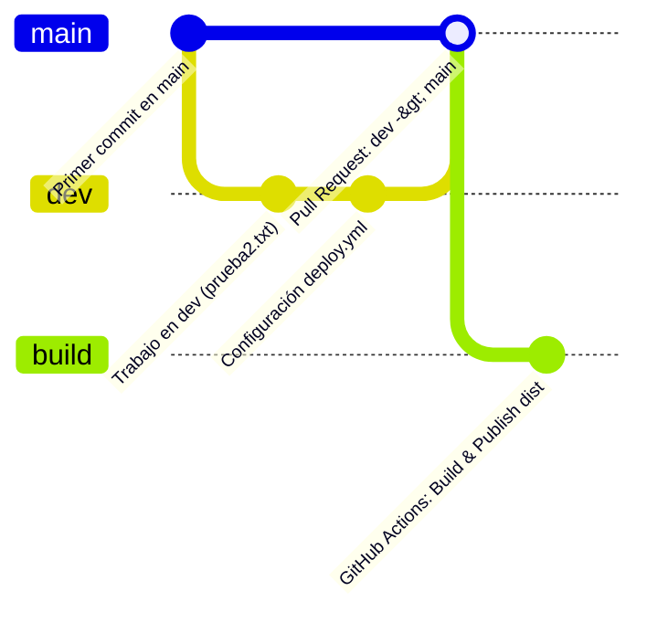

# Documento: Implementación de Flujo de Trabajo Git Flow y GitHub Actions

## Datos de la Práctica
- **Actividad**: Workflows en GitHub Actions y Git Flow
- **Estudiante**: Jonathan Ortuño
- **Repositorio Remoto**: [https://github.com/Jony-777/workflows](https://github.com/Jony-777/workflows)
- **Tecnologías**: Git, GitHub, GitHub Actions, Vite (Vanilla JS), Node.js / npm

---

## 1. Introducción al Flujo Git Flow

Git Flow es un modelo de gestión y ramificación de Git que organiza el desarrollo de software separando el código en producción del código en fase de desarrollo o características nuevas.

En este proyecto se implementaron las siguientes ramas y roles:

| Rama | Propósito | Reglas y Protecciones |
|---|---|---|
| **`main`** | Rama de producción. Contiene únicamente código estable y probado. | Protegida mediante **Branch Ruleset** (`Push validation`). Prohíbe pushes directos, force pushes y borrado; requiere Pull Request. |
| **`dev`** | Rama de desarrollo. Aquí se integran y prueban los cambios antes de publicarse a producción. | Permite trabajo colaborativo y commits directos antes de solicitar merge hacia `main`. |
| **`build`** | Rama de artefactos / despliegue. Contiene los archivos transpilados y optimizados del directorio `dist/`. | Generada y actualizada automáticamente por **GitHub Actions** al hacer merge hacia `main`. |

---

## 2. Diagrama del Flujo de Ramas y CI/CD



---

## 3. Pasos Ejecutados Detallados

### Parte 1. Configuración del Repositorio Local y Remoto
1. Se inicializó el repositorio remoto en GitHub: `https://github.com/Jony-777/workflows`.
2. En el entorno local se creó un proyecto base con Vite y se inicializó Git:
   ```bash
   git init
   git branch -M main
   git remote add origin https://github.com/Jony-777/workflows.git
   ```
3. Se creó el archivo `prueba1.txt` y la estructura inicial del proyecto.
4. Se realizó el primer commit y push a la rama principal:
   ```bash
   git add .
   git commit -m "Mi primer commit en main"
   git push -u origin main
   ```

### Parte 2. Creación y Trabajo en la Rama de Desarrollo (`dev`)
1. Se creó y cambió a la rama de desarrollo `dev`:
   ```bash
   git checkout -b dev
   ```
2. Se realizaron cambios propios del desarrollo:
   - Creación del archivo `prueba2.txt`.
   - Modificación y documentación del `README.md`.
   - Creación del workflow de CI/CD en `.github/workflows/deploy.yml`.
3. Se sincronizó la rama con GitHub:
   ```bash
   git add README.md prueba2.txt .github/
   git commit -m "Commit desde la rama de Dev - Agregado workflow y archivos de prueba"
   git push origin dev
   ```

### Parte 3. Restricción y Protección de la Rama `main`
Se configuró un **Ruleset** en GitHub con las siguientes especificaciones:
- **Nombre**: `Push validation`
- **Estado**: `Active`
- **Rama objetivo**: `main`
- **Reglas aplicadas**:
  - Restrict deletions
  - Require a pull request before merging
  - Block force pushes

**Comprobación de la protección**: Al intentar realizar un push directo a `main`:
```bash
git checkout main
git commit -m "Commit desde la rama main protegida"
git push origin main
```
GitHub rechaza la transacción con un error de violación de políticas (`GH013: Repository rule violations`), impidiendo modificaciones accidentales o no revisadas en producción.

### Parte 4. Configuración del Workflow de GitHub Actions (`deploy.yml`)
Se implementó el pipeline de automatización en `.github/workflows/deploy.yml`:

```yaml
name: Generate a build and push to another branch
on:
  push:
    branches:
      - main # Se detona cuando hay cambios integrados en main
jobs:
  build:
    runs-on: ubuntu-latest
    name: Build and Push
    steps:
      - name: git-checkout
        uses: actions/checkout@v3
      - name: Install all dependencies
        run: npm install
      - name: Build
        run: npm run build # Compila el proyecto generando la carpeta dist
      - name: Create branch if it doesn't exist
        run: git checkout -b build
      - name: Push
        uses: s0/git-publish-subdir-action@develop
        env:
          REPO: self
          BRANCH: build
          FOLDER: dist
          GITHUB_TOKEN: ${{ secrets.GITHUB_TOKEN }}
          MESSAGE: "Build: ({sha}) {msg}"
```

### Parte 5. Pull Request y Despliegue Automático
1. Se generó un **Pull Request** desde `dev` hacia `main` en la interfaz web de GitHub.
2. Al revisar y aprobar el Pull Request (**Merge pull request**), los cambios se integraron en `main`.
3. El evento `push` en `main` activó automáticamente el workflow de GitHub Actions.
4. El runner de GitHub Actions instaló dependencias, ejecutó el empaquetado de producción (`npm run build`) y publicó el contenido de la carpeta `dist` en una nueva rama llamada `build`.

---

## 4. Estructura Final del Repositorio

```
workflows/
├── .github/
│   └── workflows/
│       └── deploy.yml          # Pipeline de GitHub Actions
├── public/                     # Assets estáticos
├── src/                        # Código fuente de la aplicación Vite
├── .gitignore
├── DOCUMENTO_ENTREGA.md        # Documento explicativo
├── index.html
├── package.json
├── package-lock.json
├── prueba1.txt                 # Archivo creado en main
├── prueba2.txt                 # Archivo creado en dev
└── README.md
```

---

## 5. Resumen de Entregables

1. **Enlace del repositorio**: [https://github.com/Jony-777/workflows](https://github.com/Jony-777/workflows)
2. **Ramas verificables**:
   - `main`: [https://github.com/Jony-777/workflows/tree/main](https://github.com/Jony-777/workflows/tree/main)
   - `dev`: [https://github.com/Jony-777/workflows/tree/dev](https://github.com/Jony-777/workflows/tree/dev)
   - `build`: Generada tras la ejecución del workflow.
3. **Flujo de Pull Requests y Actions**: Registro visible en las pestañas **Pull requests** y **Actions** del repositorio.
